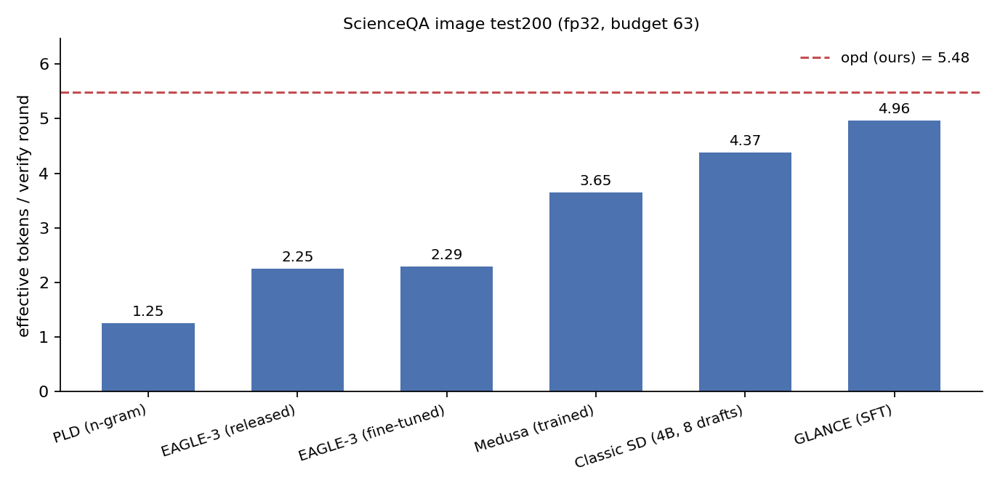
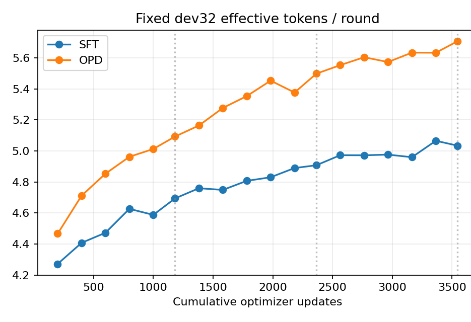

# 实验部分（组会汇报用）

> 一句话：同一 fp32 `Qwen3-VL-8B-Instruct` target、同一 test200、同一逐 token 无损门禁下，OPD 的有效 token/轮 τ 从 SFT 的 5.37 提到 6.22，准确数不变（162/200），200/200 输出与贪心 AR 完全一致。实测端到端 2.52×（相对 AR），去掉参考实现的固定开销后投影约 3.5–4×。

## 0. 实验口径

| 项 | 设置 |
|---|---|
| Target | Qwen3-VL-8B-Instruct，**全程冻结**，fp32 |
| Draft | 1.05B / 5 层块扩散头，block 16，SFT/OPD 均为 3 epoch / 3546 updates / 4 QA per update |
| 数据 | ScienceQA-IMG 去重后 4726 QA / 4352 图，两臂同序（seed 20261013–15） |
| 解码 | 贪心，budget 63，branch 8，`max_new=256`，图像长边 768，immediate EOS |
| 门禁 | 每条记录逐 token 对同一份 fp32 AR oracle，不一致即失败 |
| 评测集 | 官方 test 中排除历史 manifest 后的 **test200** |

- test200 在 step1182 已用于一次对比，step3546 是同一批 200 题的复测，不是新的独立集。
- 计时为 batch 1 完整生成（含 prefill），不含图片读取 / processor / 模型加载。

## 1. 主实验 与已发表方法的对比

| 方法 | Draft 参数 | 训练 | τ | 相对 OPD（配对 95% CI） |
|---|---:|---|---:|---:|
| **OPD（ours）** | 1.05B | 3 ep | **5.476** | — |
| Classic SD（Qwen3-VL-4B，8 步链） | 4.4B | 无 | 4.375 | −1.101 [−1.306, −0.915] |
| Medusa-1（5 头 × top-8 → 63 节点） | 0.084B | 2 ep | 3.652 | −1.824 [−1.987, −1.677] |
| EAGLE-3 同语料微调 | 0.40B | 2 ep | 2.288 | −3.188 [−3.448, −2.953] |
| EAGLE-3 发布头 | 0.40B | 无 | 2.251 | −3.225 [−3.486, −2.992] |
| PLD / n-gram 3-gram | 0 | 无 | 1.254 | −4.222 [−4.481, −3.990] |

全部 arm：200/200 逐 token 无损，准确数 162/200。

- **τ 最高的 baseline 是 classic SD 4.375**（8 次 4B 顺序前向换来的），仍低于 SFT 4.960。
- **Medusa 是最强的"训练过且便宜"的对手**：0.084B 头、2 epoch、τ 3.652；它靠"每个头从同一 root hidden 独立预测 offset"避开链式误差。
- **EAGLE-3 微调几乎不涨**：2.251→2.288（+0.037，CI [+0.020,+0.055]，相对 1.6%）。teacher-forced CE 1.74→0.25、权重动了 1.5–5%，接受长度不动——短板不是数据，是链式草稿在高熵推理开头漂移。逐记录 0/200 超过 GLANCE。
- **口径提醒**：本表 τ 是总 token / 总轮数（§1 的 6.22 是逐题 τ 的均值，SFT 同口径 5.37；两者差约 0.4–0.7，排序一致）。两条训练过的 baseline 是 2 epoch/590 更新，SFT/OPD 是 3 epoch/3546 更新，baseline 侧训练量更少（对 baseline 不利）；Medusa 的 3.65 未必是天花板。

## 2. 公平加速比

每轮的固定开销按"轮"征收，前向次数多的方法被系统性压低（EAGLE-3 每轮 10 次前向 vs 我们 2 次），所以直接横向比墙钟不公平。估算口径：保留 fp32、同树、同预算，只去掉固定开销与 launch 开销。

| 方法 | τ | 测试（含开销） | **投影加速比** |
|---|---:|---:|---:|
| AR | 1.00 | 1.00× | 1.00× |
| PLD | 1.25 | 0.60× | 1.25× |
| EAGLE-3 | 2.25 | 0.40× | 2.2× |
| Medusa | 3.65 | 0.96× | 3.6× |
| Classic SD | 4.38 | 0.56× | 0.85× |
| **OPD** | **5.48** | 2.50× | 4.1×|

## 3. SFT vs OPD（test200）

| 指标 | SFT | OPD |
|---|---:|---:|
| 有效 token/轮（题均） | 5.3666 | **6.2206** |
| 相对 SFT | — | **+0.8541**，95% CI [+0.7157, +1.0037] |
| 平均生成 token/题 | 151.35 | 151.35 |
| 验证轮数/题 | 30.5 | 27.6 |
| 答案正确 | 162/200 | 162/200 |
| SPEC = 独立 AR | 200/200 | 200/200 |

- 1182 → 3546 步：SFT 4.96→5.37，OPD 5.55→6.22，差距 +0.59→+0.85。
- OPD 的收益**全部在 τ**：准确数不变、输出逐 token 不变、只减少验证轮数。

## 4. 训练曲线（固定 dev32）

| 检查点 | 200 步 | 1182 步 | 3546 步 |
|---|---:|---:|---:|
| SFT | 4.27 | 4.69 | 5.03 |
| OPD | 4.47 | 5.09 | 5.71 |

OPD 从 200 步起就高于 SFT，且差距随训练扩大；两臂每约 200 步评一次，只看 SPEC 效率。

## 5. 速度（24 图，A6000，fp32，budget 63）

| 方法 | 完整生成 ms/题 | 生成 token/s | 相对 AR |
|---|---:|---:|---:|
| AR | 7734.4 | 18.38 | 1.000× |
| SFT | 3369.7 | 42.19 | 2.295× [2.055, 2.584] |
| OPD | 3067.4 | 46.35 | **2.522× [2.248, 2.874]** |

- SFT/OPD = **1.099× [1.063, 1.141]**；24 图中 20 图 OPD 更快，逐图中位 1.095×。
- 每轮耗时两臂相同（114.5 ms），差别只在轮数：1412 轮（SFT）vs 1286 轮（OPD）。
- 协议：24 张固定图 × 每图 2 次、每臂 2 次预热、AR 现场跑、CUDA 同步外部墙钟、所选卡无其他计算进程；144 次生成逐 token 一致。

**这是下界**：每轮还有约 50–55 ms 的固定开销（组 mask、搬张量、Python/kernel launch），占单轮 43–48%。去掉后投影 OPD ≈ 3.5–4×（上界 4.8×），见 §5。

## 6. 跨数据集与长度边界（Head 只在 ScienceQA 训练，其余零样本）

| 数据集（prompt） | 答案长度 | τ SFT/OPD | AR/SFT | AR/OPD | SFT/OPD |
|---|---:|---:|---:|---:|---:|
| ScienceQA（CoT） | 142.2 | 4.83 / 5.31 | 2.295× | 2.522× | **1.099×** |
| DocVQA（CoT） | 139.5 | 4.59 / 4.80 | 2.144× | 2.221× | 1.036× |
| MathVista（CoT） | 200.4 | 4.34 / 4.44 | 2.154× | 2.199× | 1.021× |
| ShareGPT4V（caption） | 252.6 | 3.41 / 3.46 | 1.782× | 1.821× | 1.022× |
| OCRBench（短答） | 9.6 | 3.08 / 3.04 | 1.194× | 1.204× | 1.008× |
| TextVQA（短答） | 4.3 | 3.12 / 3.22 | 1.055× | 1.050× | 0.995× |
| ChartQA（短答） | 4.6 | 3.55 / 3.33 | 1.093× | 1.022× | **0.935×** |

- 加速比由**答案长度和 prefill 占比**决定：4–10 token 短答约 1.0×，140–250 token 的 CoT/caption 为 1.8–2.5×；短答 prefill 占 73–82%，decode 收益被摊薄。
- SFT/OPD 基本等于 τ 之比：两臂每轮成本相同。
- DocVQA 同图同 head、只改 prompt：答案 6.2→139.5 token，AR/OPD 从 1.14× 升到 2.22×——加速比由答案长度决定，不是数据集。

## 7. 训练成本

| | SFT | OPD |
|---|---:|---:|
| 续训两个 epoch | 6.37 GPU-h（单卡） | 53.48 GPU-h（3 卡） |
| 相对 | 1× | **≈8.4×** |

OPD 每题要跑完整 rollout（约 30–50 轮 target block forward）；SFT 每题只做 1 次 context forward + 1 次 6-anchor head forward。

## 8. 其他实验（可选，被问到再讲）

| 实验 | 结论 |
|---|---|
| 视频长生成 OPD（10-26） | VideoDetailCaption 439 条、fresh30 n=30：warm 3.7266 → OPD 3e 3.7841（+0.0575，CI [+0.014,+0.102]），4e 回落到 3.7104；同 lr/步数 SFT 崩溃到 1.92。单 seed，不外推。 |
| 图像视觉依赖诊断（11-02） | blank-image 反事实：OPD−SFT 在高/低 g 组都约 +0.85，增益不集中在视觉依赖；六种视觉侧干预（位置加权/cutout/mismatch/2×2/3×3/attnw）均无统计支持，判阴性。 |
| 视频视觉依赖复现（11-04） | blank 视频增益 +0.2079 反而大于真实 +0.0575；visual reliance 0.652→0.502，DiD −0.1504。复现并放大了图像侧的阴性。 |
| 架构/数据夜跑（11-05） | xattn 集成失败；image layer gate 高 g −0.0040；cross-modal 阴性；mixed image+video overall +0.0224 但高 g −0.0059。无 visual-specific 优化。 |
| SpecOPD E2E-TV（11-05） | 两 seed 合并 overall +0.0245（CI 跨零），高 g +0.0392 [−0.0017,+0.0802]，最高四分位 +0.0531。唯一方向一致偏 high-g，但仍未显著。 |

## 9. 产物与复现

| 内容 | 路径 |
|---|---|
| 三卡续训最终结果 | `/mnt/local/mcy/GLANCE/results/scienceqa_continue_ep23_3gpu_20261020/` |
| 速度复测（step3546） | `/mnt/local/mcy/GLANCE/results/scienceqa_speed_step3546_20261021/` |
| baseline 复现 | `/mnt/local/mcy/GLANCE/results/baselines_20261104/`；代码 `repro/baselines/` |
| 报告 | `docs/reports/2026-10-20-scienceqa-three-card-continuation.md`、`2026-11-04-speculative-baselines.md` |
